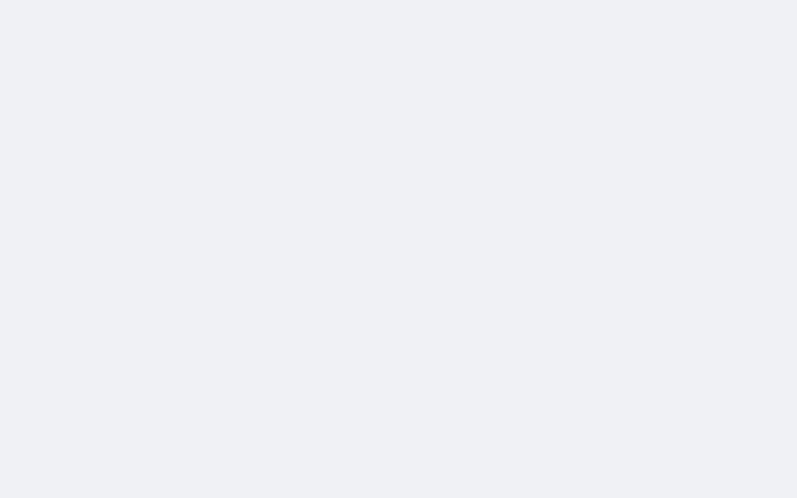
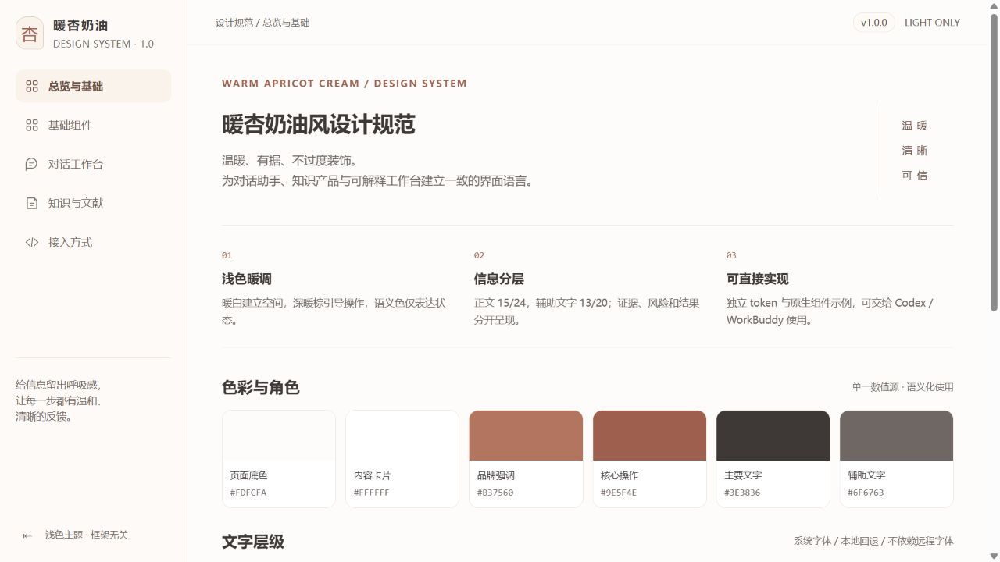
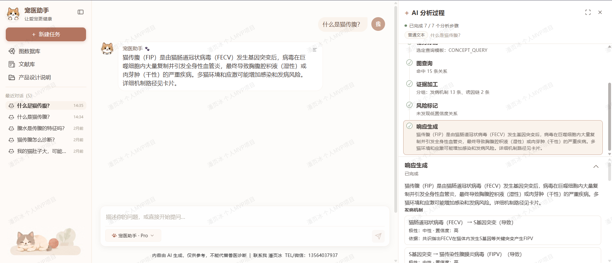
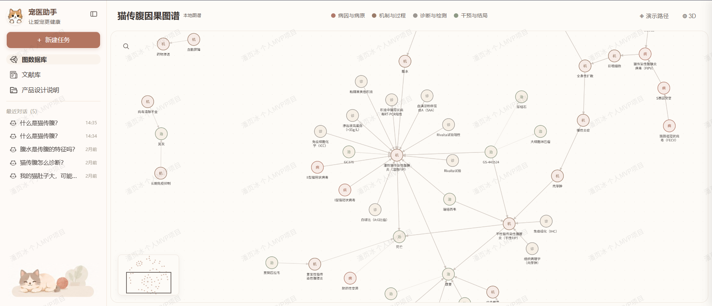
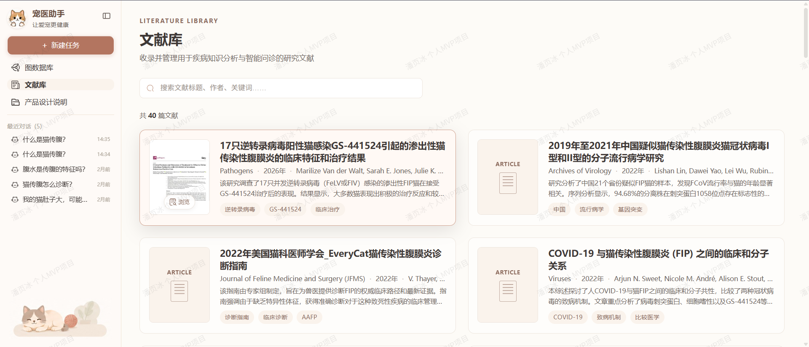
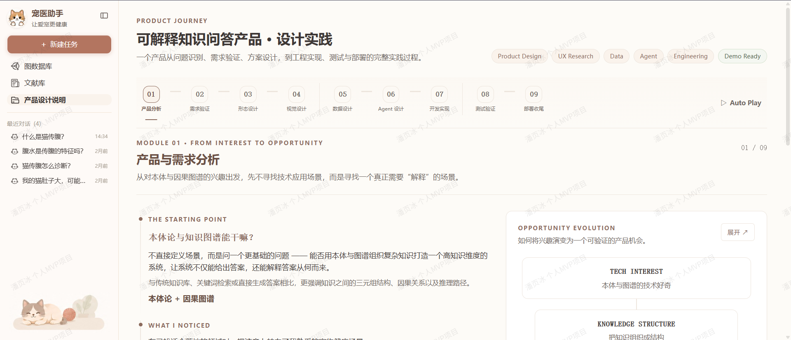

# UI 设计规范库

> 一套可维护、可被大模型（Codex / WorkBuddy 等）消费的 UI 设计规范集合。**每个子目录是一个独立设计规范**。

## 规范列表

### 标准设计系统 (design-system-ui-main) · v1.2.10

- 企业级暗/亮双主题，基于 Ant Design 6 + React 19
- 单主色靛蓝 `#5264E0`，4px 栅格，z0–z16 阴影体系
- 适用：**数据平台 / 后台管理 / AI 平台 / 图谱平台 / 数据中台**
- 📂 [进入规范子目录](./design-system-ui-main/) · 📘 [设计规范 DESIGN.md](./design-system-ui-main/DESIGN.md) · 📋 [变更日志](./design-system-ui-main/CHANGELOG.md)

### 暖杏奶油风设计规范 (warm-apricot-cream-ui) · v1.0.0

- 浅色暖调、系统字体、框架无关 token 与组件示例
- 深暖棕核心操作、暖白表面、轻量暖灰阴影
- 适用：**对话助手 / 知识问答 / 资料库 / 可解释工作台 / 宠物健康科普界面**
- 📂 [使用与接入](./warm-apricot-cream-ui/README.md) · 📘 [设计规范](./warm-apricot-cream-ui/DESIGN.md) · 🧩 [组件目录](./warm-apricot-cream-ui/COMPONENTS.md)

## 如何使用这套规范

### 给大模型用（推荐）
- **WorkBuddy**：安装对应规范的 Skill（`design-system-ui-main/ai/workbuddy/SKILL.md`）。任务开始时，Agent 会与你确认使用哪套规范后再套用。
- **Codex**：将本仓库根的 [`AGENTS.router.md`](./AGENTS.router.md) 复制为你的**项目根 `AGENTS.md`**。Codex 启动即加载，并在 UI 任务前确认规范选择。

### 给业务项目接入（开发者）
进入各规范子目录 README 的「快速开始」，按 `@/app/theme` 主题包方式接入：
`import '@/app/theme/tokens.css'` 与 `getAntdTheme('light'|'dark')`。

### 下载
GitHub 仓库页 **Code → Download ZIP** 获取完整规范库；进入子目录取所需规范即可。

## 新增一个规范
1. 在仓库根新建规范子目录，内含 `DESIGN.md`、`spec.json`、`screenshots/`、`ai/AGENTS.md`、`ai/workbuddy/SKILL.md`。
2. 在上方「规范列表」追加截图与链接。
3. 如供 Codex 多规范确认，在 `AGENTS.router.md` 的表格追加一行。
