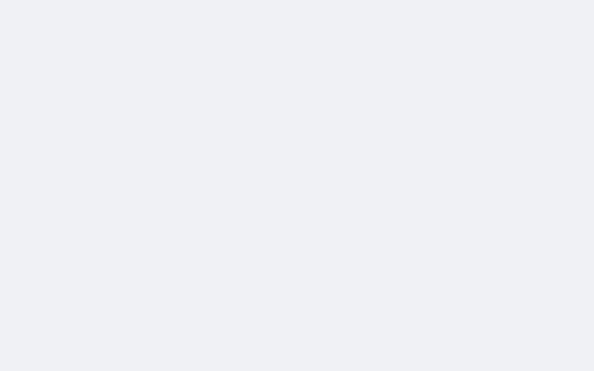

# 标准设计系统 (design-system-ui-main)

> 企业级暗/亮双主题设计规范 · v1.2.10 · [📘 设计规范 DESIGN.md](./DESIGN.md) · [📋 变更日志 CHANGELOG.md](./CHANGELOG.md)



**一句话**：基于 Ant Design 6 + React 19 的完整 token 体系与组件库，暗色优先，单主色靛蓝 `#5264E0`，4px 栅格。

**适用场景**：数据平台 · 后台管理系统 · AI 平台 · 图谱平台 · 数据中台

## 快速开始
- **给大模型用**：WorkBuddy 安装 `ai/workbuddy/SKILL.md`；Codex 将仓库根 `AGENTS.router.md` 复制为项目 `AGENTS.md`（详见[仓库根说明](../../README.md)）。任务开始前 Agent 会与你确认使用哪套规范。
- **给业务接入**：消费 `@/app/theme` 主题包 —— `import '@/app/theme/tokens.css'` 与 `getAntdTheme('light'|'dark')`。
- **下载**：GitHub Code → Download ZIP，进入本子目录取所需文件。

---

# `@/app/theme` 单包主题方案

## 目标

将现有设计规范沉淀为一个内部 npm 主题包：

```text
@/app/theme
```

这个包由 UX / 设计系统侧统一维护，但包内部需要分清两层职责：

```text
core tokens
  设计系统基础 token 层

antd adapter
  Ant Design 适配层
```

这样可以避免业务项目继续手动同步颜色、CSS Variables、AntD ThemeConfig 和组件状态样式，也避免拆成两个 npm 包后出现依赖升级和发版协调成本。

## 总体原则

`@/app/theme` 是唯一主题包。

包内必须分层：

- 根出口只暴露 core tokens，不依赖 React / AntD。
- `./antd` 子出口只负责 AntD 适配，允许依赖 React / AntD。
- 所有设计值只维护一份，AntD 适配层只能读取 core tokens，不能重新写颜色、阴影、字号等值。
- 业务项目自己的语义变量，例如 `--ui-row-bg-selected`，不进入 npm 包。

推荐使用方式：

```ts
import '@/app/theme/tokens.css';
import { tokens } from '@/app/theme';
import { getAntdTheme } from '@/app/theme/antd';
```

## 包内职责

### Core Tokens

core tokens 是设计系统基础层，负责输出框架无关、UI 库无关的 token。

应该负责：

- 颜色 token
- light / dark 主题
- 文本颜色
- 背景层级
- 边框状态
- 品牌色状态
- 阴影层级
- 间距
- 圆角
- 字号
- 行高
- 字重
- 动效
- 组件基础尺寸，例如 button height、input height、card padding
- `--ds-*` CSS Variables
- 标准化 `tokens.json`
- TypeScript token 和类型声明

不应该负责：

- AntD `ThemeConfig`
- AntD 字段名
- React Provider
- Vue 插件
- Tailwind preset
- 业务变量 `--ui-*`
- 业务组件样式
- 业务状态 class

示例 token：

```text
bg-base
bg-sidebar
bg-header
bg-card
bg-elevated
bg-input
bg-overlay

text-primary
text-secondary
text-tertiary
text-link
text-inverse

border
border-hover
border-active
divider

primary
primary-hover
primary-active
primary-subtle

shadow-z0
shadow-z1
shadow-z2
shadow-z4
shadow-z8
shadow-z16
```

### AntD Adapter

antd adapter 是 Ant Design 适配层，负责把 core tokens 映射成 AntD 可消费的主题配置。

应该负责：

- 读取 core tokens
- 生成 AntD `ThemeConfig`
- 输出 `getAntdTheme(mode)`
- 输出 `lightTheme`
- 输出 `darkTheme`
- 输出 `AppThemeProvider`
- 处理 AntD 5 / 6 差异
- 处理 React 19 兼容说明
- 提供必要的 overrides 白名单

不应该负责：

- 重新维护颜色值
- 重新维护阴影值
- 重新维护字号值
- 重新生成 `--ds-*`
- 维护业务变量 `--ui-*`
- 维护业务组件样式

AntD adapter 示例：

```ts
import type { ThemeConfig } from 'antd';
import { theme } from 'antd';
import { tokens } from '@/app/theme';

export function getAntdTheme(mode: 'light' | 'dark'): ThemeConfig {
  const token = tokens[mode];

  return {
    algorithm: mode === 'dark' ? theme.darkAlgorithm : theme.defaultAlgorithm,
    token: {
      colorPrimary: token.primary,
      colorPrimaryHover: token.primaryHover,
      colorPrimaryActive: token.primaryActive,
      colorText: token.textPrimary,
      colorTextSecondary: token.textSecondary,
      colorTextTertiary: token.textTertiary,
      colorTextLightSolid: token.textInverse,
      colorBgLayout: token.bgBase,
      colorBgContainer: token.bgCard,
      colorBgElevated: token.bgElevated,
      colorBorder: token.border,
      colorBorderSecondary: token.divider,
      colorSplit: token.divider,
      boxShadow: token.shadowZ8,
      boxShadowSecondary: token.shadowZ4,
      boxShadowTertiary: token.shadowZ1
    },
    components: {
      Button: {
        primaryColor: token.textInverse,
        dangerColor: token.textInverse,
        solidTextColor: token.textInverse
      },
      Table: {
        headerBg: token.bgElevated,
        borderColor: token.divider,
        rowHoverBg: token.neutralBg,
        rowSelectedBg: token.primarySubtle,
        rowSelectedHoverBg: token.primarySubtle
      },
      Card: {
        colorBgContainer: token.bgCard,
        colorBorderSecondary: token.border
      }
    }
  };
}
```

## 推荐目录结构

```text
@/app/theme
  src/
    tokens/
      source/
        colors.json
        spacing.json
        typography.json
        shadow.json
        motion.json
      generated/
        tokens.css
        tokens.json
        tokens.generated.ts
      index.ts
    antd/
      getAntdTheme.ts
      AppThemeProvider.tsx
      index.ts
    index.ts
  dist/
    index.js
    index.d.ts
    tokens.css
    tokens.json
    antd/
      index.js
      index.d.ts
  package.json
```

## 推荐 package exports

```json
{
  "name": "@/app/theme",
  "type": "module",
  "exports": {
    ".": {
      "types": "./dist/index.d.ts",
      "import": "./dist/index.js"
    },
    "./tokens.css": "./dist/tokens.css",
    "./tokens.json": "./dist/tokens.json",
    "./antd": {
      "types": "./dist/antd/index.d.ts",
      "import": "./dist/antd/index.js"
    }
  }
}
```

## 推荐 peerDependencies

根出口不依赖 AntD，只有 `./antd` 子出口依赖 AntD 和 React。

为了让非 AntD 项目也能只消费 tokens，建议把 AntD 和 React 配成 optional peer dependencies：

```json
{
  "peerDependencies": {
    "antd": "^5.0.0 || ^6.0.0",
    "react": "^19.0.0",
    "react-dom": "^19.0.0"
  },
  "peerDependenciesMeta": {
    "antd": {
      "optional": true
    },
    "react": {
      "optional": true
    },
    "react-dom": {
      "optional": true
    }
  }
}
```

业务项目如果只用：

```ts
import '@/app/theme/tokens.css';
import { tokens } from '@/app/theme';
```

不应该被迫安装 AntD。

业务项目如果用：

```ts
import { getAntdTheme } from '@/app/theme/antd';
```

则需要业务项目自身安装 `antd`、`react`、`react-dom`。

## 输出产物

### CSS Variables

```ts
import '@/app/theme/tokens.css';
```

示例：

```css
:root,
[data-theme='dark'] {
  color-scheme: dark;

  --ds-bg-base: #0a0c10;
  --ds-bg-card: #1c1e24;
  --ds-bg-elevated: #252830;
  --ds-text-primary: #d0d2d8;
  --ds-text-secondary: #8a8f99;
  --ds-text-inverse: #ffffff;
  --ds-border: #2a2e38;
  --ds-border-hover: #3a3f4d;
  --ds-border-active: #5264e0;
  --ds-primary: #5264e0;
  --ds-primary-hover: #6b80f0;
  --ds-primary-active: #3f50c0;
  --ds-primary-subtle: rgba(82, 100, 224, 0.12);
  --ds-shadow-z1: 0 1px 2px rgba(0, 0, 0, 0.3);
  --ds-shadow-z2: 0 2px 12px rgba(0, 0, 0, 0.35);
}

[data-theme='light'] {
  color-scheme: light;

  --ds-bg-base: #f0f1f5;
  --ds-bg-card: #ffffff;
  --ds-bg-elevated: #f5f6fa;
  --ds-text-primary: #1d1f23;
  --ds-text-secondary: #5c5f66;
  --ds-text-inverse: #ffffff;
  --ds-border: #e4e5e9;
  --ds-border-hover: #d0d2d8;
  --ds-border-active: #5264e0;
  --ds-primary: #5264e0;
  --ds-primary-hover: #3f50c0;
  --ds-primary-active: #2d40b0;
  --ds-primary-subtle: rgba(82, 100, 224, 0.08);
  --ds-shadow-z1: 0 1px 2px rgba(0, 0, 0, 0.06);
  --ds-shadow-z2: 0 2px 8px rgba(0, 0, 0, 0.08);
}
```

### TypeScript tokens

```ts
import { tokens, lightTokens, darkTokens } from '@/app/theme';
```

推荐类型：

```ts
export type ThemeMode = 'light' | 'dark';
export type ThemeTokenValue = string | number | undefined;
export type ThemeTokens = Readonly<Record<string, ThemeTokenValue>>;

export declare const lightTokens: ThemeTokens;
export declare const darkTokens: ThemeTokens;
export declare const tokens: Readonly<Record<ThemeMode, ThemeTokens>>;
```

### AntD 子出口

```ts
import { getAntdTheme, lightTheme, darkTheme, AppThemeProvider } from '@/app/theme/antd';
```

推荐输出：

```ts
export type ThemeMode = 'light' | 'dark';
export type ThemeOverrides = Partial<{
  token: ThemeConfig['token'];
  components: Pick<NonNullable<ThemeConfig['components']>, 'Button' | 'Table' | 'Card' | 'Input' | 'Select'>;
}>;

export declare const lightTheme: ThemeConfig;
export declare const darkTheme: ThemeConfig;
export declare function getAntdTheme(mode: ThemeMode, overrides?: ThemeOverrides): ThemeConfig;
export declare function AppThemeProvider(props: AppThemeProviderProps): JSX.Element;
```

## 业务项目接入方式

### 1. 引入 tokens.css

```ts
import '@/app/theme/tokens.css';
```

### 2. 业务项目保留 `--ui-*` 兼容层

业务项目可以继续维护：

```text
src/themes/theme-vars.css
```

但只做兼容别名：

```css
--ui-text-primary: var(--ds-text-primary);
--ui-text-secondary: var(--ds-text-secondary);
--ui-text-tertiary: var(--ds-text-tertiary);
--ui-text-inverse: var(--ds-text-inverse);

--ui-bg-layout: var(--ds-bg-base);
--ui-bg-card: var(--ds-bg-card);
--ui-bg-elevated: var(--ds-bg-elevated);

--ui-border: var(--ds-border);
--ui-border-hover: var(--ds-border-hover);
--ui-border-active: var(--ds-border-active);

--ui-row-bg-selected: var(--ds-primary-subtle);
--ui-shadow-card: var(--ds-shadow-z1);
--ui-shadow-card-hover: var(--ds-shadow-z2);
```

`--ui-*` 是业务语义，不进入 npm 包。

### 3. 使用 AntD 适配

```tsx
import { ConfigProvider } from 'antd';
import { getAntdTheme } from '@/app/theme/antd';

export function App() {
  return (
    <ConfigProvider theme={getAntdTheme('light')}>
      <YourApp />
    </ConfigProvider>
  );
}
```

或：

```tsx
import { AppThemeProvider } from '@/app/theme/antd';

export function App() {
  return (
    <AppThemeProvider mode="light">
      <YourApp />
    </AppThemeProvider>
  );
}
```

## 更新流程

### 只修改 token 值

例如：

```text
primary 从 #5264e0 改为 #3b82f6
```

只修改 core tokens。

发版：

```text
@/app/theme@1.x.x
```

### 新增 token，但 AntD 不需要使用

例如：

```text
info-subtle
surface-warning
```

只修改 core tokens。

发版：

```text
@/app/theme@1.x.x
```

### 新增 token，并且 AntD 需要映射

例如新增：

```text
focus-ring
```

并且 AntD `Input`、`Button`、`Select` 都需要用。

修改：

```text
core tokens
antd adapter
```

仍然只发一个包：

```text
@/app/theme@1.x.x
```

### AntD 升级

例如：

```text
antd@5 -> antd@6
```

只修改 antd adapter。

core tokens 不需要变。

仍然只发一个包：

```text
@/app/theme@1.x.x
```

如果 Provider API 或映射行为有 breaking change，则发 major：

```text
@/app/theme@2.0.0
```

### 删除或重命名 token

这是 breaking change。

发版：

```text
@/app/theme@2.0.0
```

## 版本策略

| 变更类型 | 修改范围 | 版本建议 |
| --- | --- | --- |
| 修改 token 值 | core tokens | patch 或 minor |
| 新增 token | core tokens | minor |
| 新增 AntD 映射 | antd adapter | minor |
| 新增 token 且 AntD 使用 | core tokens + antd adapter | minor |
| 删除 token | core tokens | major |
| 重命名 token | core tokens | major |
| AntD 兼容增强 | antd adapter | minor |
| AntD 映射 breaking change | antd adapter | major |
| Provider API breaking change | antd adapter | major |

## AntD 5 / 6 与 React 19

推荐 peer 范围：

```text
antd: ^5.0.0 || ^6.0.0
react: ^19.0.0
react-dom: ^19.0.0
```

业务项目如果使用：

```text
antd@5 + React 19
```

需要在业务入口引入：

```ts
import '@ant-design/v5-patch-for-react-19';
```

业务项目如果使用：

```text
antd@6 + React 19
```

不需要 patch。

## GitLab Package Registry 发布建议

`.npmrc` 示例：

```ini
@app:registry=https://gitlab.example.com/api/v4/projects/<project-id>/packages/npm/
//gitlab.example.com/api/v4/projects/<project-id>/packages/npm/:_authToken=${NPM_TOKEN}
```

发布命令：

```bash
pnpm install
pnpm run build
pnpm publish --access restricted
```

CI 建议配置：

```text
NPM_TOKEN
```

## 验收清单

### Core Tokens 验收

- `--ds-*` 只来自 token JSON 生成
- `tokens.css`、`tokens.json`、TypeScript tokens 内容一致
- light / dark 均有值
- token 命名是语义化的，不以具体色值命名
- 不包含 AntD 字段名
- 不包含业务变量 `--ui-*`
- 不包含业务组件样式

### AntD Adapter 验收

- 所有值都来自 core tokens
- 不重新维护颜色、阴影、字号
- 有色按钮文本使用 `text-inverse`
- Card 默认阴影对应 `shadow-z1`
- Card hover 对应 `border-hover + shadow-z2`
- Card selected 对应 `border-active`
- Table row hover / selected 映射稳定
- AntD 5 / 6 差异被隔离在 adapter 内
- 根出口不引入 AntD
- 只有 `@/app/theme/antd` 引入 AntD

### 业务项目验收

- 业务项目不手写 `--ds-*`
- `theme-vars.css` 只维护 `--ui-* -> --ds-*`
- `antd-theme.ts` 可逐步替换为 `@/app/theme/antd`
- 业务 CSS 不新增硬编码颜色
- light / dark 切换正常

## 推荐推进顺序

### 第一阶段：抽 core tokens

迁移当前业务项目中的：

```text
docs/design-system/*.json
docs/design-system/sync-design-system-tokens.mjs
```

生成：

```text
tokens.css
tokens.json
tokens.generated.ts
```

### 第二阶段：同包内增加 antd adapter

新增：

```text
src/antd/getAntdTheme.ts
src/antd/AppThemeProvider.tsx
src/antd/index.ts
```

### 第三阶段：业务项目接入

业务项目改为：

```ts
import '@/app/theme/tokens.css';
import { getAntdTheme } from '@/app/theme/antd';
```

继续保留：

```text
src/themes/theme-vars.css
```

作为业务兼容层。

## 最终说明

`@/app/theme` 是一个 npm 包。

包内分两层：

```text
core tokens
antd adapter
```

core tokens 负责设计系统语义。

antd adapter 负责 AntD 映射。

以后颜色、背景、边框、阴影、字体等设计 token 更新，只发这一个包。

以后 AntD 升级，也只发这一个包，但只改包内的 `antd adapter`。
