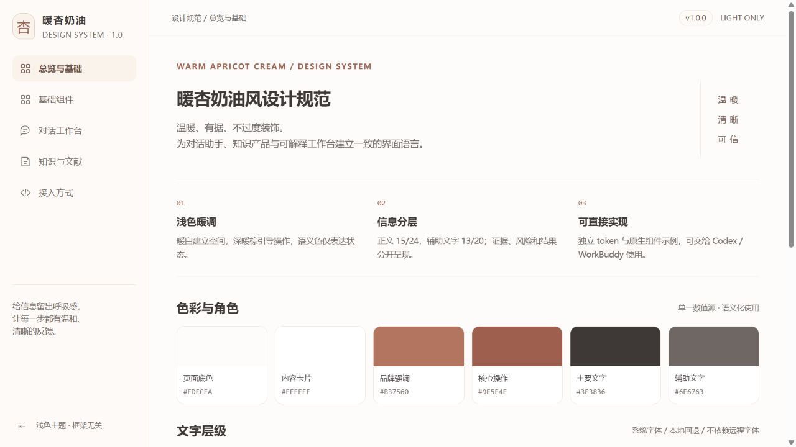
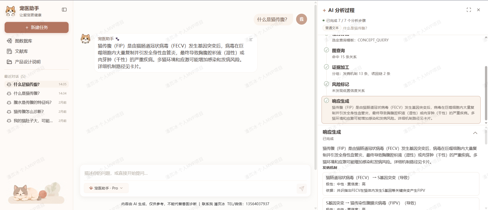
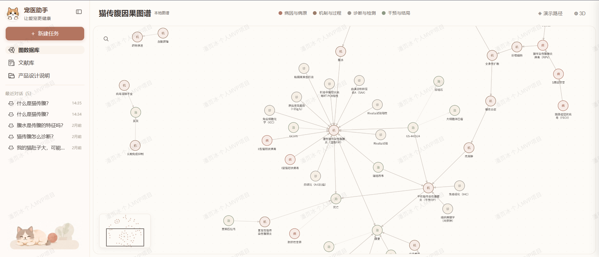
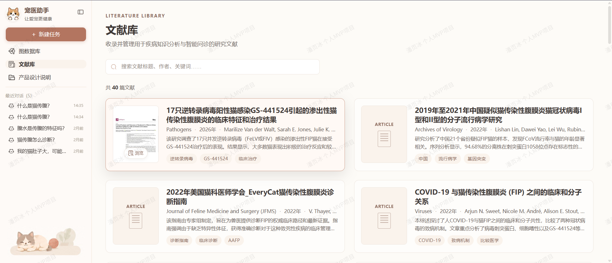
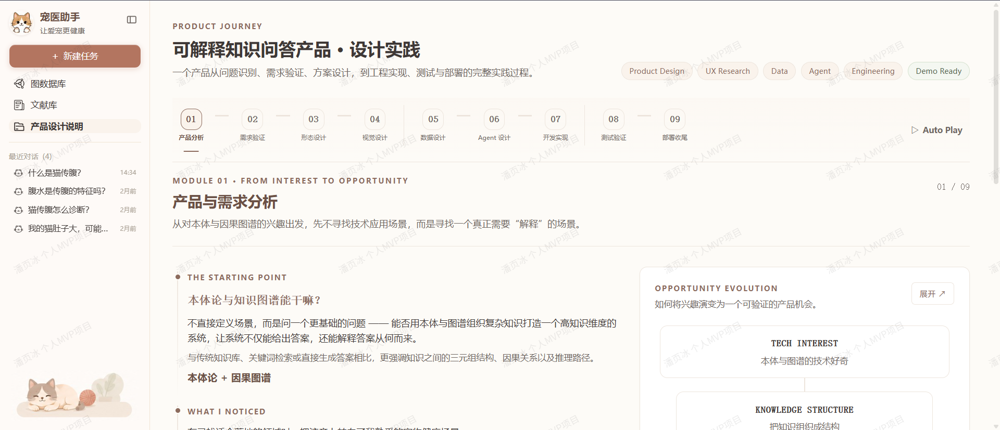

# 暖杏奶油风设计规范 · v1.0.0

英文标识与目录：`warm-apricot-cream-ui`。与 `design-system-ui-main` 并列、独立维护。

适用：对话助手、知识问答、宠物健康科普界面、资料库、可解释推理/图谱工作台。浅色暖调，框架无关。

## 界面预览











截图用于视觉参考；数值与行为以本套 token 和 DESIGN.md 为准。

## 给 Codex / WorkBuddy

将完整目录放在 Agent 可以读取的位置。明确指定：

> 使用“暖杏奶油风设计规范”，目录为 `<实际绝对路径>/warm-apricot-cream-ui`。先读 `ai/AGENTS.md`、`DESIGN.md`、`packages/theme/src/tokens.json` 和 `COMPONENTS.md`，按需参考 `packages/docs` 中的可运行示例。保留当前项目技术栈。

Codex：将仓库根 AGENTS.router.md 模板接入目标项目，并替换规范库路径。WorkBuddy：加载 `ai/workbuddy/SKILL.md`，同时保留可访问的完整规范目录。复制一个指引文件不会自动安装组件或依赖。

读取优先级：用户明确要求 > 本套 token 数值与 DESIGN 行为规则 > 组件目录 > 示例。冲突处理与规范化决定见 `references/extraction-decisions.md`。

## 本地构建、测试与预览

仅需 Node.js 20+；预览与 HTTP 验证另需 Python 3.9+。本套不需要 npm install，不产生自己的 node_modules，不运行旧项目或连接业务系统。

```bash
cd warm-apricot-cream-ui
npm run build
npm test
npm run docs:dev
# → http://127.0.0.1:8081
```

自选端口或主动打开浏览器：

```bash
python scripts/serve_docs.py --port 8082 --open
```

先执行 build。预览服务只提供 docs 和生成的 theme 资源，不提供整个工作区。Windows 使用 python；其他环境可按实际安装情况使用 python3。

## 接入前端项目

选一种方式：

1. **直接复制 CSS**：构建后复制 `packages/theme/dist/tokens.css` 与 `components.css` 到业务项目，再按其构建工具引入。
2. **本地 npm 包**：在本规范根运行 `npm run theme:pack`，将生成的 `warm-apricot-cream-theme-1.0.0.tgz` 安装到目标项目。

```bash
npm install /实际路径/warm-apricot-cream-theme-1.0.0.tgz
```

```tsx
import '@warm-apricot-cream/theme/tokens.css';
import '@warm-apricot-cream/theme/components.css';

export function Example() {
  return <main className="wac-root" data-design-system="warm-apricot-cream-ui">
    <button className="wac-button">主要操作</button>
  </main>;
}
```

仅取数值：

```js
import { tokens, colors, typography, layout } from '@warm-apricot-cream/theme';
```

真实包名是 `@warm-apricot-cream/theme`，未假定在 npm registry 发布；没有 getAntdTheme、React Provider 或 Gradio 自动适配。组件 CSS 提供样式，事件、路由与业务数据由目标框架实现。交互参考 `packages/docs/app.js`，不要虚构 React 组件出口。

普通 HTML：按实际相对地址用两个 `<link rel="stylesheet">` 加载上述 CSS，DOM 示例见 docs。Gradio：在正确的 HTML/CSS 注入入口使用生成 CSS 与 wac-root 作用域，框架覆写仅放项目适配层，不复制旧项目的全局 reset 与强制补丁。

## 维护

新增或替换截图时，同步更新本 README、仓库根 README 的预览及 `spec.json` 的 `screenshots` 清单。

数值只改 `packages/theme/src/tokens.json`，行为/样式改 DESIGN 与 `src/components.css`，再构建并测试。断点由构建器从 token 填充；不要直接使用带占位符的源组件 CSS。

- 只提供浅色主题，不伪造暗色值。
- 命名空间为 `--wac-*` / `.wac-*`，不复用另一套规范的 `--ds-*`。
- 允许轻微暖灰静态阴影；文献条目使用平面变体。
- 4px 是布局基线，不禁止已明示的控件内边距例外。
- 样式提炼不等于真实推理能力、医学结论或业务系统接通。
- 修改后运行 npm test，检查键盘、状态、响应式与实际目标项目构建。

本套为首次独立发布 v1.0.0，不沿用原项目“V2”或另一规范的版本号。原始 fip-causal-reasoning 仅作为提炼来源，不是运行依赖。
